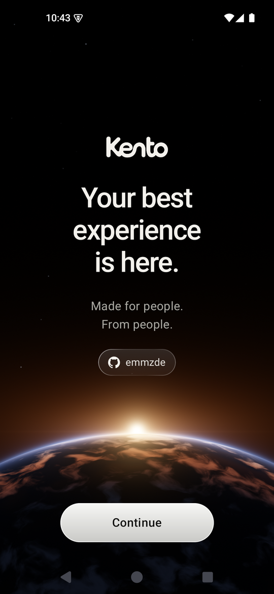
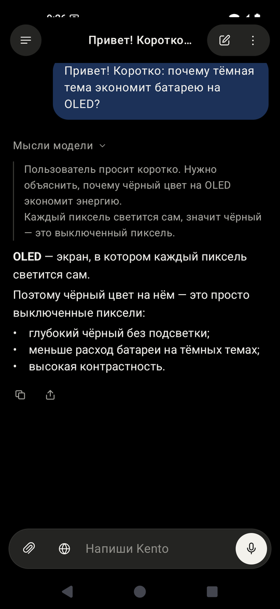
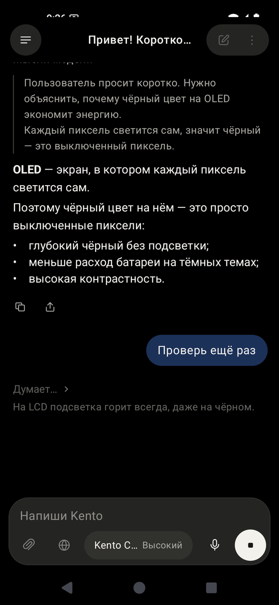
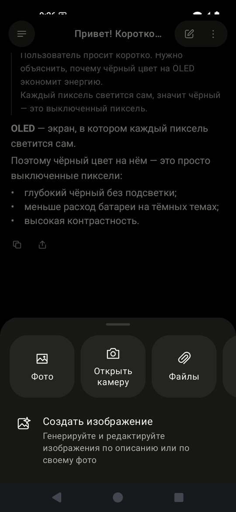
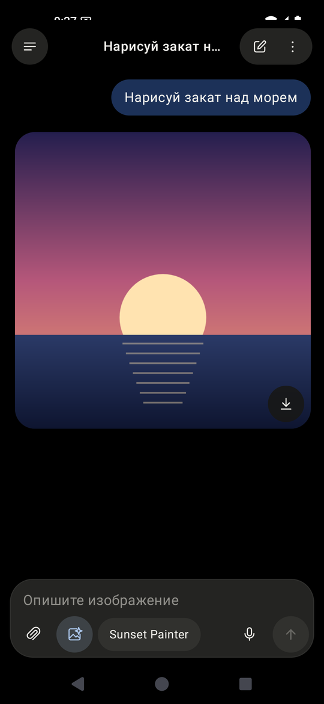
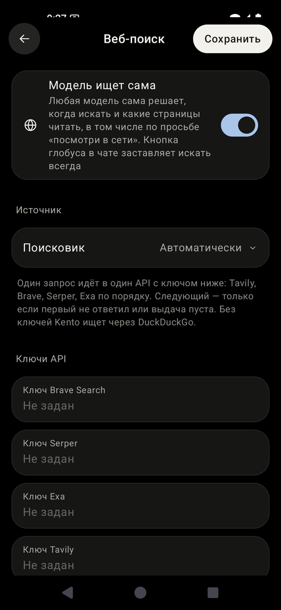
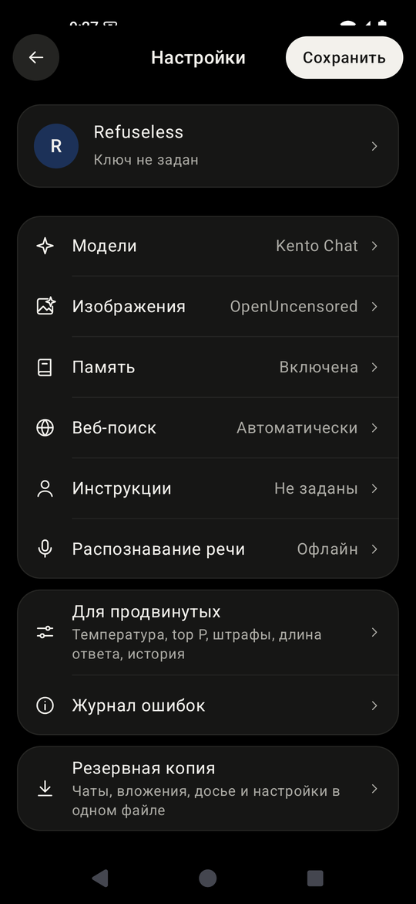

# Kento

Native Android chat client for LLMs. Bring your own key: Kento talks straight to the provider's API from the
phone, there is no backend of its own. Chats, attachments and the memory dossier live in a local Room database.

Text models go through [Refuseless](https://refuseless.com) (OpenAI-compatible Chat Completions with streaming and
tool calls), image generation and editing through [OpenUncensored](https://openuncensored.com).

<p align="center">
  
  
  
</p>

## Features

- **BYOK.** API keys are entered in Settings and stored encrypted with an Android Keystore key. Nothing is baked
  into the build.
- **Streaming chat** over SSE with Markdown, code highlighting, tables and LaTeX. Reasoning models show their
  thoughts live; the reasoning level is picked per model from what the catalogue publishes.
- **Local history.** Room database with migrations and a full-text index; backup and restore to a single file.
- **Web search as a tool.** The model decides when to search and which pages to read. Tavily, Brave, Serper or Exa
  with a key, DuckDuckGo Lite without one. Sources are linked under the answer.
- **Memory.** Long chats are folded into a summary in the background so the prompt prefix stays cacheable.
  A background model keeps a dossier of facts about the user; the model can search it and past chats via
  `memory_search`.
- **Attachments.** Photos (with EXIF), PDF with a text layer, audio. OCR (Tesseract) and transcription
  (whisper.cpp, built through the NDK) run on the device and work offline.
- **Voice input.** System recognizer on Android 14+, bundled multilingual Whisper otherwise, or a cloud
  Whisper endpoint.
- **Images.** Text-to-image and edits of attached photos, saved to `Pictures/Kento`.
- Russian and English UI, OLED-black theme, Android 8.0+.

<p align="center">
  
  
  
  
</p>

## Project structure

```
Kento/
├── app/                    entry point: MainActivity, navigation, welcome screen
│   └── src/androidTest/    UI journeys against MockWebServer, Room migration tests
├── core/
│   ├── text/               i18n: tr("…") lookups, English strings
│   └── ui/                 theme, shared Compose components, icons
├── data/                   everything below the UI
│   ├── db/                 Room entities, DAOs, migrations (schemas in data/schemas)
│   ├── net/                Refuseless / OpenUncensored clients, SSE stream reader, catalogue
│   ├── tools/              tool-call loop between the model and local tools
│   ├── web/                search engines, page fetch and extraction, web tools
│   ├── memory/             context layout, chat summaries, dossier, memory_search
│   ├── media/              OCR, PDF, audio, Whisper, image generation, gallery
│   ├── settings/           DataStore settings, encrypted key storage
│   ├── backup/             export / import
│   └── cpp/                JNI bridge to whisper.cpp
├── feature/
│   ├── chat/               chat screen, composer, streaming Markdown, history drawer
│   └── settings/           settings pages, dossier editor, error journal
└── tools/                  emulator launcher and test scripts (PowerShell), bench helpers
```

Dependencies go one way: `feature/*` → `data` → `core/*`. `app` wires them together.

Stack: Kotlin 2.2, Jetpack Compose (Material 3), Room 2.8 + KSP, DataStore, OkHttp, kotlinx.serialization,
WorkManager, CommonMark, jsoup, PDFBox, Tesseract4Android, whisper.cpp.

## Building

Requirements:

- JDK 17
- Android Studio with AGP 8.13 support, or the command-line SDK with platform 36
- NDK 26.3.11579264 and CMake 3.22.1 (SDK Manager → SDK Tools)

```sh
git clone https://github.com/emmzde/Kento.git
cd Kento
cp local.properties.example local.properties   # set sdk.dir, or let Android Studio create it
./gradlew assembleDebug
```

The APK ends up in `app/build/outputs/apk/debug/`. On Windows use `gradlew.bat`. The first build downloads the
whisper.cpp sources and speech models and checks them against pinned SHA-256 hashes, so it takes a while.

Other build types:

- `assemblePreview` — minified build signed with the debug key, for quick installs.
- `assembleRelease` — minified; signed only if `KENTO_KEYSTORE` or `~/.kento/keystore.properties` points to a
  keystore (`storeFile`, `storePassword`, `keyAlias`, `keyPassword`), unsigned otherwise.

On Windows, `Kento.cmd` boots an emulator, installs the preview build and opens the app.

### Keys

The app needs no keys at build time. After install, open Settings and paste a Refuseless key (and an
OpenUncensored key for images, search engine keys if you want them).

Live tests and benches hit paid APIs and are skipped by default. To run them, copy `.env.example` to `.env`, fill in
the keys and set `KENTO_LIVE=1` or `KENTO_BENCH=1`.

## Tests

```sh
./gradlew test                       # JVM unit tests
./gradlew connectedQaAndroidTest     # instrumented tests on a device or emulator
```

## License

[MIT](LICENSE). Bundled whisper.cpp, Whisper and Tesseract data keep their own licenses (`data/src/main/assets/licenses`).
